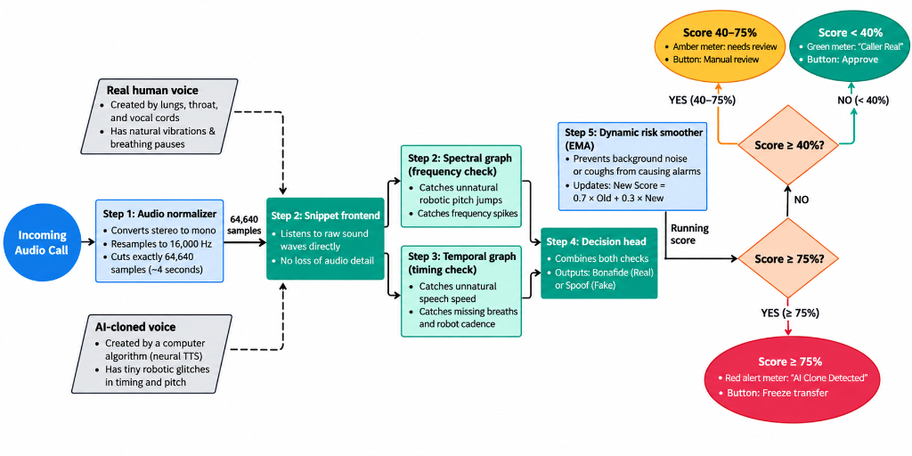
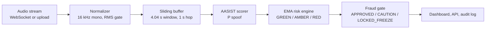

# 🛡️ Voice Shield

**Real-time AI voice-clone detection for banking calls: a streaming FastAPI service that scores live audio with a fine-tuned AASIST model and drives a simulated fraud-prevention flow (step-up OTP, account freeze, supervisor unlock).**


> **Research prototype built for a Smart India Hackathon problem statement.** It demonstrates the architecture end to end, but it is **not** a production fraud system. See [Limitations](#limitations).

**Live demo (Render free tier, may take about a minute to wake):** https://voice-shield-kf0h.onrender.com



## The problem

Voice-cloning tools can imitate a bank customer or executive on a phone call. Voice Shield listens to the call as a stream, estimates how likely the voice is synthetic, and escalates: allow, ask for extra verification, or block the transaction.

## How it works



| Stage | File | Details |
|---|---|---|
| Normalize | `backend/normalizer.py` | Mono, resample to 16 kHz, **RMS noise-floor gate (0.015)** so room hum is scored as silence, peak-normalise, repeat-tile or centre-crop to 64,600 samples. |
| Buffer | `backend/buffer.py` | FIFO sliding window: 64,600 samples (about 4.04 s), emitted every 1.0 s. |
| Score | `backend/scorer.py`, `src/models/aasist*.py` | **AASIST** (SincConv front end + spectro-temporal graph attention) on the raw waveform; outputs P(spoof). |
| Risk | `backend/risk_engine.py` | Exponential moving average `risk = 0.7 × risk_prev + 0.3 × P(spoof)`, starting at 5%. **GREEN < 40%, AMBER < 75%, RED ≥ 75%.** |
| Gate | `backend/fraud_gate.py` | `APPROVED` → `CAUTION` (transfer held, step-up OTP or security question) → `LOCKED_FREEZE` (transactions blocked until a supervisor unlocks). |
| Sessions | `backend/service.py` | Per-call sessions and an in-memory account registry (simulated bank accounts). |

**Detection time.** With the default EMA and frame scores near 1.0, risk crosses 75% on the **4th scored window**. The first window needs 4.04 s of audio and windows advance every 1 s, so a freeze comes after roughly **7 seconds of sustained cloned speech**. The 12.7 ms figure below is model compute per window, not end-to-end detection time.

## Model and results

AASIST (NAVER Corp., MIT licence) fine-tuned on the **IndieFake** dataset (Indian-accented English). `aasist_core.py` is the upstream architecture, kept with its licence notice. Fine-tuning code, data loading, streaming service and all risk and fraud logic are original to this repo.

Held-out unseen speakers (`evaluation_results/metrics.json`, produced by `src/evaluation/evaluate.py`):

| Metric | Value |
|---|---|
| **Equal Error Rate** | **13.48%** (the pretrained model on the same split: 46.03%, see `benchmark_summary.md`) |
| ROC-AUC | 95.18% |
| Accuracy at EER threshold | 86.39% |
| Mean latency per 4 s window | 12.67 ms (p95 12.93 ms) on an RTX 3060 Laptop GPU, real-time factor 0.0031 |
| Peak GPU memory | 2,940 MB |
| Parameters / checkpoint | 297,866 / 1.22 MB |

**How to read the EER.** At the threshold where the two error rates are equal, about **13.5% of spoofed clips are accepted and about 13.5% of genuine clips are rejected.** That is a useful research result, but it is far from carrier-grade; real systems need much lower error rates.

**Note on precision/recall in `metrics.json`.** The file also lists precision 20.16%, recall 86.67% and F1 32.7%. These are computed with the **genuine-speech class as "positive"** (the evaluation script prints "Precision (Bonafide)"), on a test split where the low precision is consistent with spoofs being the majority. They are not spoof-detection precision and recall, so use the EER instead.

### Noise robustness (small sanity check)

`tests/test_enterprise_suite.py` adds Gaussian noise at 20 dB and 10 dB SNR to **10 curated clips (3 genuine, 7 synthetic, several generated with gTTS)** and checks the risk tier; all were classified correctly. With only 10 clips, and noise that is not real telephone-channel distortion, treat this as a smoke test, not a robustness claim.

## Features

- **REST + WebSocket API** (`main.py`): call start, audio upload, status, simulated inquiry/transfer, OTP send/verify/cancel, security-question check, unfreeze, admin account lock/unlock, `/health`, Swagger at `/docs`, live stream at `/ws/call/{call_id}`.
- **Operator dashboard** (`static/dashboard.html`, served at `/dashboard`): live waveform and risk gauge, simulated voice-banking conversation, forensic file scanner, audit ledger, admin panel.
- **Python SDK** (`sdk/client.py`, example in `sdk/examples/`) for integrating with other systems.
- **Docker** image (CPU-only PyTorch) and `render.yaml` for deployment.

## Run it

```bash
git clone https://github.com/Naman225/voice-shield.git
cd voice-shield
python -m venv .venv && source .venv/bin/activate
pip install -r requirements.txt

python main.py                       # dashboard: http://localhost:8000/dashboard
python test_stream.py                # stream a human clip then a clone over WebSocket
python src/evaluation/test_audio.py --audio test_samples/demo_voice_clone.mp3
python src/evaluation/evaluate.py    # needs the IndieFake dataset
```

Docker:

```bash
docker build -t voice-shield .
docker run -p 8000:8000 voice-shield
```

Tests:

```bash
python tests/test_conversation_flow.py   # API lifecycle: inquiry, transfer, AMBER hold, OTP resume
python tests/test_enterprise_suite.py    # normalizer, buffer, risk engine, gate, noise checks
```

## Training

- `src/pipeline/train.py`: fine-tunes AASIST on IndieFake with EER-based checkpointing (produces `best_indiefake_aasist.pth`, the deployed model).
- `train.py` + `train_config.yaml` + `src/pipeline/train_multilingual.py`: **experimental** Hindi/Tamil fine-tuning mixed with 30% English. No results are reported for it yet.

## Repository structure

```
main.py                 FastAPI app, REST endpoints, WebSocket
backend/                normalizer, buffer, scorer, risk_engine, fraud_gate, service
src/models/             aasist.py (loader), aasist_core.py (upstream architecture)
src/pipeline/           dataset, normalize, train, train_multilingual
src/evaluation/         evaluate.py, test_audio.py
sdk/                    VoiceShieldClient + example
static/                 dashboard.html, demo audio
tests/                  conversation flow and enterprise suite
checkpoints/            fine-tuned weights
evaluation_results/     metrics.json, plots, benchmark summary
Dockerfile, render.yaml
```

## Limitations

- **Accuracy:** EER of 13.5% is not production-grade. Hindi/Tamil and other accents are untested.
- **Operating point is not calibrated.** The EER threshold used in evaluation corresponds to P(spoof) of about 0.11, while the runtime tiers use 40% and 75% on a smoothed score. Real runtime error rates are therefore unknown.
- **No real telephony.** Audio comes from files or a browser stream. Real phone calls are often 8 kHz narrowband with codec compression (G.711, AMR), which was not tested; the model works at 16 kHz.
- **No authentication on any endpoint**, including the admin routes. Account state is **in memory** and lost on restart.
- **The "evidence hash" is only an identifier** (SHA-256 of timestamp and risk score). It is not a signature of the audio and not tamper-proof; a real system needs signed, append-only audit storage.
- The banking flow (balances, transfers, OTP) is **simulated**.
- No adversarial testing (attacks designed to evade the detector).
- Single worker, free-tier hosting.

## Roadmap

- Calibrate thresholds on held-out data and report operating-point error rates at the runtime tiers
- Telephony-style evaluation (8 kHz, codecs, packet loss) and larger test sets
- API authentication, persistent storage, signed audit log
- Measure CPU latency inside the Docker image

## Licence and attribution

MIT. AASIST architecture © NAVER Corp. ([clovaai/aasist](https://github.com/clovaai/aasist), MIT). Check the IndieFake dataset's own terms before redistributing data or weights trained on it.

## Author

Built by [Naman Tiwari](https://github.com/Naman225).
